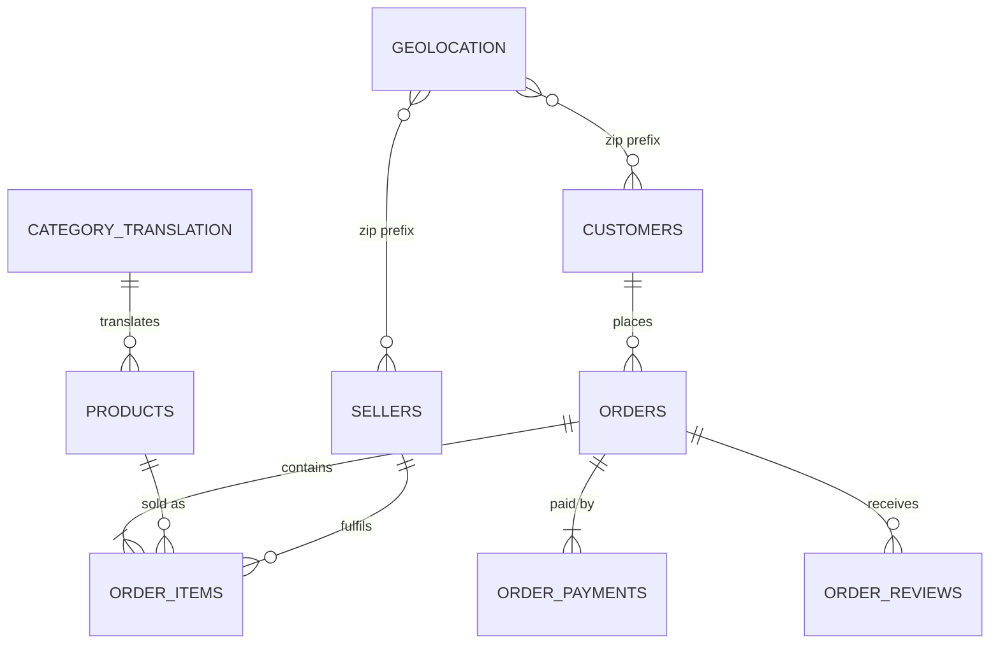
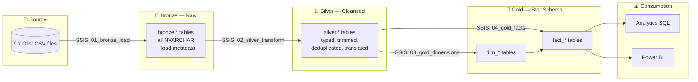
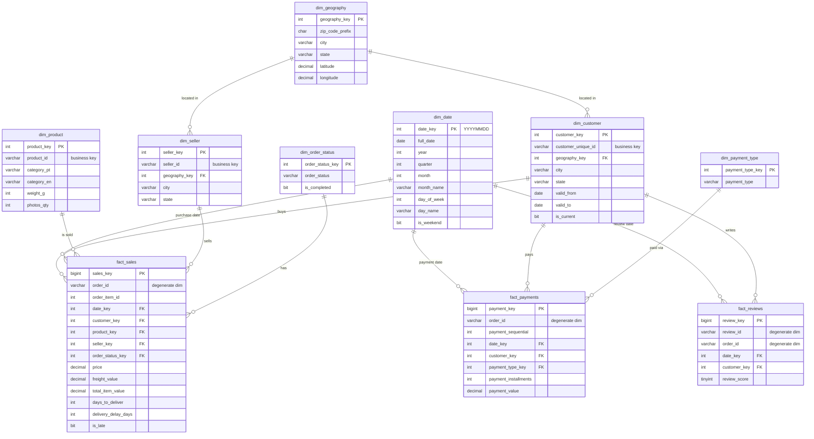
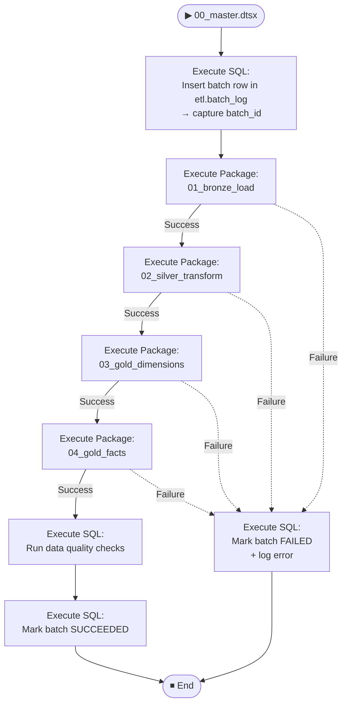

# 🛒 Olist E-Commerce Data Warehouse — SSIS Medallion Project

> **BrightLearn Data Engineering Project**
> Build an end-to-end ETL pipeline on SQL Server using **SSIS** and the **Medallion Architecture** (Bronze → Silver → Gold), model a **Star Schema**, then document it with **draw.io** and **Mermaid** diagrams.
>
> 📅 **Due: Sunday, 15 November 2026 (23:59 SAST)**


<p align="center">
  
</p>

<p align="center">
  
  
  
  
  
</p>

---

## 📌 Table of Contents

1. [Project Overview](#-project-overview)
2. [Dataset](#-dataset)
3. [Tools & Prerequisites](#-tools--prerequisites)
4. [Architecture](#-architecture)
5. [Repository Structure](#-repository-structure)
6. [Naming Conventions](#-naming-conventions)
7. [Phase 1 — Bronze Layer](#-phase-1--bronze-layer-raw)
8. [Phase 2 — Silver Layer](#-phase-2--silver-layer-cleansed)
9. [Phase 3 — Gold Layer (Star Schema)](#-phase-3--gold-layer-star-schema)
10. [Phase 4 — SSIS Orchestration & Logging](#-phase-4--ssis-orchestration--logging)
11. [Phase 5 — Data Quality Tests](#-phase-5--data-quality-tests)
12. [Phase 6 — Analytics Queries](#-phase-6--analytics-queries)
13. [Documentation Requirements (draw.io + Mermaid)](#-documentation-requirements-drawio--mermaid)
14. [Deliverables Checklist](#-deliverables-checklist)
15. [Assessment Rubric](#-assessment-rubric)
16. [Known Data Quirks](#-known-data-quirks-read-this)

---

## 🎯 Project Overview

You are a Data Engineer at **Olist**, a Brazilian e-commerce marketplace. The business has 9 raw CSV extracts and no warehouse. Your job:

| # | Objective |
|---|-----------|
| 1 | Ingest all raw CSVs into a **Bronze** layer using SSIS, untouched |
| 2 | Clean, standardise and deduplicate into a **Silver** layer |
| 3 | Model a **Star Schema** in the **Gold** layer for reporting |
| 4 | Orchestrate everything from **one master SSIS package** with logging |
| 5 | Prove data quality with **tests** and answer **business questions** |
| 6 | Document the solution with **draw.io** and **Mermaid** diagrams |

### 🎯 End Goal — What You Will Hand In

One GitHub repo that proves the whole pipeline works, starting from an empty SQL Server:

1. **Working pipeline** — CSVs → Bronze → Silver → Gold, run end-to-end by one master package (`00_master.dtsx`)
2. **Star schema** — declared grains, surrogate keys, `-1` Unknown rows, SCD Type 2 on customers
3. **Proof** — 10 data quality tests passing, and 8 analytics questions answered from Gold only
4. **Documentation** — 3 draw.io diagrams, 3+ Mermaid diagrams, data dictionary, data lineage, and a README explaining your design decisions

### 🗓️ Suggested Timeline

| Week | Dates | Milestone |
|------|-------|-----------|
| 1 | 21 – 25 Oct | Repo set up, dataset explored, draw.io architecture + star schema drafted, DDL scripts written |
| 2 | 26 Oct – 1 Nov | **Bronze** loaded via SSIS, row counts reconciled; **Silver** transforms started |
| 3 | 2 – 8 Nov | **Silver** complete, **Gold** dims + facts loaded, master package + logging working |
| 4 | 9 – 15 Nov | Data quality tests, analytics queries, documentation, final README → **submit by 15 Nov** |

---

## 📦 Dataset

**Brazilian E-Commerce Public Dataset by Olist** — ~100k orders, 2016–2018

🔗 https://www.kaggle.com/datasets/olistbr/brazilian-ecommerce

### Business context

Olist is a Brazilian marketplace aggregator: small merchants sell through the **Olist Store** and ship directly to customers via Olist's logistics partners. After a customer buys, the **seller is notified** to fulfil the order. Once the product arrives (or the estimated delivery date passes), the customer receives a **satisfaction survey** by email to score the purchase and leave comments.

This is **real commercial data**, anonymised. Store and partner names in review text were replaced with **Game of Thrones great house names** (e.g. Stark, Lannister). Treat these as text, not as data errors.

### ⚠️ Three rules that drive your model

1. **An order can have multiple items** → `fact_sales` grain is the *order item*, not the order
2. **Each item can be fulfilled by a different seller** → `seller_key` lives on the fact row, not on the order
3. **Payments and reviews are at order level** → separate facts; never join items ↔ payments directly

| File | Description | Grain |
|------|-------------|-------|
| `olist_customers_dataset.csv` | Customer + location | 1 row per `customer_id` (per order!) |
| `olist_orders_dataset.csv` | Order header + status + timestamps | 1 row per order |
| `olist_order_items_dataset.csv` | Items in each order, price, freight | 1 row per order item |
| `olist_order_payments_dataset.csv` | Payment method + value | 1 row per payment |
| `olist_order_reviews_dataset.csv` | Review score + comments | 1 row per review |
| `olist_products_dataset.csv` | Product attributes | 1 row per product |
| `olist_sellers_dataset.csv` | Seller + location | 1 row per seller |
| `olist_geolocation_dataset.csv` | Zip prefix → lat/lng | ⚠️ many rows per zip |
| `product_category_name_translation.csv` | Portuguese → English categories | 1 row per category |

**Raw data relationships (source system):**



---

## 🧰 Tools & Prerequisites

| Tool | Purpose |
|------|---------|
| SQL Server 2019+ (Developer Edition) | Database engine |
| SQL Server Management Studio (SSMS) | Querying & admin |
| Visual Studio 2022 + **SQL Server Integration Services Projects** extension | Build SSIS packages |
| draw.io (app.diagrams.net or desktop) | Architecture + ERD + flow diagrams |
| Git + GitHub | Version control & submission |
| Power BI Desktop *(optional bonus)* | Dashboard on Gold layer |

> 💡 Mermaid diagrams render automatically on GitHub inside ` ```mermaid ` code blocks. No install needed.

---

## 🎨 Colour Key & Tools by Stage

Use these colours in every draw.io diagram and chart so the layers match across the project.

### Colour key

| Layer | Badge | Hex (draw.io fill) |
|-------|-------|--------------------|
| 🟫 Bronze (raw) |  | `#CD7F32` |
| ⬜ Silver (cleansed) |  | `#C0C0C0` |
| 🟨 Gold (star schema) |  | `#FFD700` |
| ⚙️ Audit / orchestration |  | `#6B7280` |
| 📊 Consumption |  | `#2563EB` |
| ✅ Test passes |  | `#15803D` |
| ❌ Test fails |  | `#B91C1C` |

### Tools you will use

| Stage | Tool | Used for |
|-------|------|----------|
| 📁 Source and every layer |  | Database engine |
| 🟫 ⬜ 🟨 Load and transform |  | Packages, data flows, lookups, SCD |
| 🧾 Build SQL and run checks |   | DDL, `MERGE`, tests, analytics |
| ⚙️ Orchestration |   | `00_master.dtsx`, batch logging |
| 📊 Consumption |  | Optional dashboard on Gold |
| 🧩 Documentation |   | Architecture, ERD, SSIS flow |
| 🗂️ Version control |   | Shared repo, reviews, submission |

---

## 🏗️ Architecture



| Layer | Schema | Rule |
|-------|--------|------|
| Bronze | `bronze` | Load **as-is**. No cleaning. Truncate & reload. Add metadata columns. |
| Silver | `silver` | Correct data types, trim, fix casing, dedupe, handle nulls, translate. One table per source entity. |
| Gold | `gold` | Business-ready star schema. Surrogate keys. Facts at a declared grain. |
| Audit | `etl` | Package run logs, row counts, errors. |

---

## 📂 Repository Structure

Your repo **must** follow this layout:

```
olist_ssis_dwh/
├── README.md                     # Your own project README (see deliverables)
├── data/
│   ├── README.md                 # Kaggle link only
│   └── raw/                      # Place the 9 source CSVs here — DO NOT commit (git-ignore this folder)
├── docs/
│   ├── architecture.drawio
│   ├── architecture.png
│   ├── star_schema.drawio
│   ├── star_schema.png
│   ├── ssis_flow.drawio
│   ├── ssis_flow.png
│   ├── data_dictionary.md
│   └── data_lineage.md
├── sql/
│   ├── 00_create_database.sql
│   ├── 01_create_schemas.sql
│   ├── 02_bronze_ddl.sql
│   ├── 03_silver_ddl.sql
│   ├── 04_gold_ddl.sql
│   ├── 05_etl_audit_ddl.sql
│   └── 06_analytics_queries.sql
├── ssis/
│   └── olist_dwh/                # Visual Studio SSIS solution
│       ├── 00_master.dtsx
│       ├── 01_bronze_load.dtsx
│       ├── 02_silver_transform.dtsx
│       ├── 03_gold_dimensions.dtsx
│       └── 04_gold_facts.dtsx
└── tests/
    └── data_quality_checks.sql
```

---

## 🏷️ Naming Conventions

| Object | Convention | Example |
|--------|-----------|---------|
| Database | `olist_dwh` | — |
| Bronze tables | `bronze.<source_name>` | `bronze.olist_orders` |
| Silver tables | `silver.<entity>` | `silver.orders` |
| Dimensions | `gold.dim_<name>` | `gold.dim_customer` |
| Facts | `gold.fact_<name>` | `gold.fact_sales` |
| Surrogate keys | `<dim>_key` (INT IDENTITY) | `customer_key` |
| Business keys | Keep source name | `customer_unique_id` |
| Metadata columns | Prefix `dwh_` | `dwh_load_ts`, `dwh_source_file`, `dwh_batch_id` |
| SSIS packages | `NN_layer_action.dtsx` | `02_silver_transform.dtsx` |
| Columns | `snake_case` | `order_purchase_ts` |
| Primary keys | `pk_<table>` | `pk_dim_customer` |
| Foreign keys | `fk_<table>_<ref_table>` | `fk_fact_sales_dim_customer` |
| Variables & parameters | `snake_case` | `batch_id`, `source_folder` |
| Folders & files | `snake_case`, lowercase | `data/raw/`, `sql/03_silver_ddl.sql` |

> ✅ **snake_case everywhere.** Use lowercase letters, digits and underscores only. No spaces, hyphens, CamelCase or UPPERCASE names. This applies to every SQL object, column, SSIS package, parameter, file and folder. Documentation prose and diagram titles may use normal English.

---

## 🔁 Re-runnable & Duplicate-Safe (pass/fail)

Every script and package must be safe to run again. Running the whole pipeline **twice** on the same server must give the **same row counts** and **no duplicate rows**.

| Layer | Rule |
|-------|------|
| DDL scripts (`sql/`) | Guard every create (`IF NOT EXISTS` or `CREATE OR ALTER`). A re-run must not error and must not drop data. |
| Bronze | Truncate and reload on every run. Never append. |
| Silver | Rebuild each table from Bronze in one transaction (truncate + insert), **or** MERGE on the business key. Never blind insert. |
| Gold dimensions | MERGE on the business key so **surrogate keys stay the same across runs**. Insert the `-1` Unknown row only if it is missing. |
| `dim_date` | Insert only dates that do not already exist. |
| SCD2 (`dim_customer`) | A re-run with no source change must create **no** new version. |
| Gold facts | Truncate and reload, or delete the batch's rows before insert. Never append on top of old rows. |
| Audit (`etl.*`) | A new `batch_id` per run. Appending to audit tables is expected here. |
| Master package | A failed run can be restarted from the top with no manual cleanup. |

> 🧪 **Re-run test (required):** run `00_master.dtsx` twice. Every table must show the same row count both times, `etl.batch_log` must show two batches, and all 10 data quality tests must still return 0 rows.

---

## 🥉 Phase 1 — Bronze Layer (Raw)

---

## 🥉 Phase 1 — Bronze Layer (Raw)

**Goal:** Every CSV lands in SQL Server exactly as it arrived.

### Tasks
- [ ] Create database `olist_dwh` and schemas `bronze`, `silver`, `gold`, `etl`
- [ ] Create 9 Bronze tables — **all columns `NVARCHAR`** (no type casting here)
- [ ] Add metadata columns to every Bronze table:
  - `dwh_load_ts DATETIME2 DEFAULT SYSDATETIME()`
  - `dwh_source_file NVARCHAR(260)`
  - `dwh_batch_id INT`
- [ ] Build `01_bronze_load.dtsx`:
  - Execute SQL Task → `TRUNCATE` all Bronze tables
  - Data Flow per file: **Flat File Source → Derived Column (metadata) → OLE DB Destination**
  - **Bonus:** use a **Foreach Loop Container** with an expression-driven connection
- [ ] Flat File Connection settings:
  - Code page **65001 (UTF-8)** — Portuguese characters (ç, ã, é) will break otherwise
  - Text qualifier: `"`
  - Header row: yes
- [ ] Log row counts per file to `etl.load_log`

### ✅ Acceptance
Row counts in Bronze **match** the CSV record counts (minus header). Record both in `docs/data_lineage.md`.

> 💡 Count **records**, not physical lines. Review comments contain line breaks (quirk #9), so `wc -l` or a line count will overcount.

---

## 🥈 Phase 2 — Silver Layer (Cleansed)

**Goal:** Typed, clean, deduplicated, trustworthy data.

### Required transformations

| Silver table | Must do |
|--------------|---------|
| `silver.customers` | Trim, proper-case `city`, upper-case `state`, pad zip prefix to 5 chars |
| `silver.orders` | Cast all timestamps to `DATETIME2`, standardise `order_status`, flag `is_delivered` |
| `silver.order_items` | Cast `price` / `freight_value` to `DECIMAL(10,2)`, derive `total_item_value` |
| `silver.order_payments` | Cast types, standardise `payment_type` (e.g. `not_defined` → `Unknown`) |
| `silver.order_reviews` | **Dedupe on `review_id`**, cast `review_score` to `TINYINT`, keep comments as NVARCHAR(MAX) |
| `silver.products` | Fix misspelt columns (`product_name_lenght` → `product_name_length`), join English category, null category → `Unknown` |
| `silver.sellers` | Same standardisation as customers |
| `silver.geolocation` | **Collapse to 1 row per zip prefix** (e.g. average lat/lng, most frequent city) |
| `silver.category_translation` | Add the missing translations (see [quirks](#-known-data-quirks-read-this)) |

### Tasks
- [ ] Build `02_silver_transform.dtsx` using **at least**: Data Conversion, Derived Column, Lookup, Conditional Split
- [ ] Route bad rows (failed casts, null keys) to `etl.error_rows` — **do not silently drop them**
- [ ] Add `dwh_load_ts` to every Silver table

---

## 🥇 Phase 3 — Gold Layer (Star Schema)

**Goal:** A business-friendly star schema at clearly declared grains.

### Declared grains

| Fact | Grain |
|------|-------|
| `gold.fact_sales` | **One row per order item** |
| `gold.fact_payments` | **One row per payment line** per order |
| `gold.fact_reviews` | One row per review — **required**, because analytics Q3 and Q8 need review scores |

> ⚠️ Do **not** put `payment_value` on `fact_sales`. Orders have multiple items **and** multiple payments — joining them causes fan-out and double counting. That's why payments get their own fact.

### Star schema



### Tasks
- [ ] `dim_date` — generate 2016-01-01 → 2019-12-31 via SQL script (not from source data)
- [ ] `dim_product`, `dim_seller`, `dim_geography`, `dim_order_status`, `dim_payment_type` — one per entity in the star schema above (`dim_geography` is the zip-prefix dimension that customers and sellers point to)
- [ ] `fact_reviews` — one row per review, with `date_key` and `customer_key` looked up the same way as the other facts
- [ ] All dimensions get an **`-1` Unknown row** so facts never have NULL foreign keys
- [ ] `dim_customer` — use `customer_unique_id` as business key (**not** `customer_id`)
- [ ] **SCD Type 2** on `dim_customer` (city/state) — use the SSIS **Slowly Changing Dimension** wizard *or* a `MERGE` in an Execute SQL Task. Justify your choice in your README. The source has no change dates, so use `order_purchase_ts` as the `valid_from` date for each city/state version.
- [ ] `03_gold_dimensions.dtsx` loads all dims **before** `04_gold_facts.dtsx`
- [ ] Facts use SSIS **Lookup** transforms to swap business keys for surrogate keys; no-match rows → `-1`
- [ ] Derived measures on `fact_sales`: `days_to_deliver`, `delivery_delay_days`, `is_late`

---

## ⚙️ Phase 4 — SSIS Orchestration & Logging



### Tasks
- [ ] `00_master.dtsx` calls child packages with **Execute Package Tasks** (Project Deployment Model)
- [ ] Pass `batch_id` from master → children via **Parent Package Parameters**
- [ ] Use **Project Connection Managers** + **Project Parameters** for server/database/file path — **no hard-coded paths**
- [ ] Create audit tables:
  - `etl.batch_log` (batch_id, start_ts, end_ts, status)
  - `etl.load_log` (batch_id, package, table_name, rows_read, rows_written, rows_error, ts)
  - `etl.error_rows` (batch_id, table_name, error_code, error_column, raw_row)
- [ ] **Bonus:** deploy to SSISDB catalog and schedule via SQL Server Agent

---

## 🧪 Phase 5 — Data Quality Tests

Write these in `tests/data_quality_checks.sql`. Each test returns **0 rows** when it passes.

| # | Test | Layer |
|---|------|-------|
| 1 | Bronze row count = CSV row count | Bronze |
| 2 | No duplicate `review_id` | Silver |
| 3 | One row per `zip_code_prefix` in geolocation | Silver |
| 4 | No NULL business keys in any dimension | Gold |
| 5 | Every surrogate key is unique per dimension | Gold |
| 6 | No orphan FKs in facts (every FK exists in its dim) | Gold |
| 7 | `SUM(fact_sales.price)` = `SUM(silver.order_items.price)` | Gold |
| 8 | `SUM(fact_payments.payment_value)` = `SUM(silver.order_payments.payment_value)` | Gold |
| 9 | Only one `is_current = 1` row per `customer_unique_id` | Gold |
| 10 | No negative prices or freight values | Silver |

---

## 📊 Phase 6 — Analytics Queries

Answer these from the **Gold layer only** in `sql/06_analytics_queries.sql`:

1. Monthly revenue and order count trend (2017–2018)
2. Top 10 product categories (English) by revenue
3. Top 10 sellers by revenue and their average review score
4. % of orders delivered late, by customer state
5. Average delivery days by seller state → customer state (top 10 routes)
6. Payment type mix by revenue and average installments
7. Repeat customer rate (customers with > 1 order, using `customer_unique_id`)
8. Does late delivery hurt review scores? (avg score: late vs on-time)

> 💡 Q3 and Q8 use review scores, which are **order-level**. To attribute reviews to sellers, go through the distinct `(order_id, seller_key)` pairs in `fact_sales`. Do not join reviews straight onto item rows, or you will double-count.

**Bonus:** build a 1-page Power BI dashboard on top of Gold and add a screenshot to `docs/`.

---

## 📐 Documentation Requirements (draw.io + Mermaid)

You must document your project using **both** tools:

### draw.io (3 diagrams — required)

Save each as **`.drawio`** (editable source) **and** export **`.png`** into `docs/`.

| Diagram | File | Must show |
|---------|------|-----------|
| **1. Solution Architecture** | `docs/architecture.drawio` | Source → Bronze → Silver → Gold → Consumption; tools at each stage (SSIS, SQL Server, Power BI); audit/logging layer |
| **2. Star Schema ERD** | `docs/star_schema.drawio` | All facts + dims, PKs, FKs, crow's-foot cardinality, grain labelled on each fact |
| **3. SSIS Package Flow** | `docs/ssis_flow.drawio` | Master → child packages, precedence constraints (success/failure), logging steps |

**draw.io tips**
- Use the **Entity Relation** shape library for the ERD (`More Shapes → Entity Relation`)
- Colour-code layers consistently: 🟫 Bronze · ⬜ Silver · 🟨 Gold
- `File → Export as → PNG` with **"Include a copy of my diagram"** ticked, so the PNG is still editable

### Mermaid (in your own README — required)

Your project README must include **at least 3 Mermaid diagrams** rendered on GitHub:

- [ ] Architecture `flowchart`
- [ ] Gold layer `erDiagram`
- [ ] SSIS orchestration `flowchart` **or** a `sequenceDiagram`

Embed your draw.io PNGs too:

```markdown

```

### Written docs (required)

| File | Contents |
|------|----------|
| `docs/data_dictionary.md` | Every Gold table + column: name, type, description, source column |
| `docs/data_lineage.md` | Row counts per table per layer + explanation of any differences |

---

## ✅ Deliverables Checklist

> Submit your GitHub repo link by **15 November 2026, 23:59 SAST**. Commits after the deadline won't be marked.

- [ ] Public GitHub repo following the [structure above](#-repository-structure)
- [ ] All SQL DDL scripts run cleanly on an empty server, in order
- [ ] SSIS solution opens and `00_master.dtsx` runs end-to-end with **no hard-coded paths**
- [ ] Bronze, Silver, Gold populated; `etl.load_log` shows a successful batch
- [ ] 10 data quality tests passing
- [ ] 8 analytics queries answered (results pasted as comments or a table in README)
- [ ] 3 draw.io diagrams (`.drawio` + `.png`)
- [ ] 3+ Mermaid diagrams in your README
- [ ] Data dictionary + data lineage docs
- [ ] Your README includes: overview, how to run, design decisions, challenges & lessons learned
- [ ] Re-run test passes: two `00_master.dtsx` runs, same counts, no duplicates
- [ ] All names are snake_case (database, schemas, tables, columns, packages, parameters, files, folders)
- [ ] Presentation delivered in mid-November
- [ ] Short demo video (≤ 5 min) *(bonus)*

---

## 🎤 Presentation (mid-November)

- **When:** mid-November 2026. The exact date and time are **to be confirmed** by the facilitator.
- **Format (proposed, to confirm):** live run of `00_master.dtsx`, then the star schema, the re-run test, the data quality results, and lessons learned.
- **Everyone presents** at least one part of the pipeline.
- **Be ready to explain:** each declared grain, one design decision, and one data quirk you handled.

---

## 🏆 Assessment Rubric

| Area | Weight | What "excellent" looks like |
|------|-------:|-----------------------------|
| Bronze ingestion | 10% | All files loaded, UTF-8 correct, counts reconciled |
| Silver cleansing | 20% | All quirks handled, bad rows captured not dropped |
| Gold modelling | 25% | Correct grains, surrogate keys, Unknown rows, SCD2 working |
| SSIS orchestration | 15% | Master/child, parameters, failure paths, audit logging |
| Data quality | 10% | All 10 tests present and passing |
| Analytics | 5% | Correct answers from Gold only |
| Documentation | 15% | Clear draw.io + Mermaid diagrams, data dictionary, lineage, design rationale |
| **Re-runnability & naming** | **Pass / fail** | Two master runs give the same counts with no duplicates. Every name is snake_case. A failure fails the affected area. |
| **Presentation** | **TBC** | Mid-November. Weight to be confirmed by the facilitator. |

---

## ⚠️ Known Data Quirks (Read This!)

These are **deliberate learning opportunities**. Handle each one in Silver and explain how in your README.

| # | Quirk | Hint |
|---|-------|------|
| 1 | `customer_id` is **per order**, not per person | Use `customer_unique_id` as the real customer |
| 2 | Geolocation has **many rows per zip prefix** | Aggregate to 1 row per zip before joining |
| 3 | `review_id` has **duplicates** | Dedupe — keep the latest `review_answer_timestamp` |
| 4 | Columns misspelt: `product_name_lenght`, `product_description_lenght` | Rename in Silver |
| 5 | Some products have **NULL category** | Map to `Unknown` |
| 6 | 2 categories missing from translation file (`pc_gamer`, `portateis_cozinha_e_preparadores_de_alimentos`) | Add them to `silver.category_translation` |
| 7 | Portuguese accents (São Paulo, ç, ã) | Flat File code page **65001** + `NVARCHAR` |
| 8 | Same city spelt differently (e.g. `sao paulo` vs `são paulo`) | Standardise case; accent-stripping is a bonus |
| 9 | Review comments contain **commas and line breaks** | Text qualifier `"` — then reconcile row counts |
| 10 | Undelivered/cancelled orders have **NULL delivery dates** | Don't compute delivery days for them; keep the rows |
| 11 | Orders have **multiple items and multiple payments** | Separate facts — never join items ↔ payments directly |

---

### 🙋 Need help?

Raise questions in the cohort channel. Show what you tried, the error message, and a screenshot of your SSIS package/data flow.

**Good luck — build it like it's going to production. 🚀**
